# CPE 334 Software Engineering
# LAB 04 : TokTickIT Actions Taken, Dashboards, and Final Regression.

**Course:** CPE 334 Introduction to Software Engineering in the Age of AI Agents (Semester 1/2026)  
**Total Points:** 60 Points  
**Student Name:** Aran Edlek (อรัญ อีดเหล็ก) — Student ID: 67070505230 (GitHub: [`aranedlek`](https://github.com/aranedlek))  
**Peer Reviewer Name:** Jinjutha Nannarumit (จินจุฑา นันนฤมิตร) — Student ID: 67070505232 (GitHub: [`Ponatinylilbug`](https://github.com/Ponatinylilbug))  
**Repository:** [https://github.com/aranedlek/toctickit](https://github.com/aranedlek/toctickit)  
**Integration Workflow:** Feature branches -> `lab4-staging` -> `main`  
**Release Pull Request:** PR #45 (Release: Lab 04 — Final Sprint Release) — **Status: MERGED ✅**

---

## Answer Part 1: Git Use with Engineering Workflow

### 1.1 Git Workflow

Development strictly followed the staged integration workflow where each issue was developed on an isolated feature branch (`feature/lab4-issue-1-spec` through `feature/lab4-issue-6-hardening`), reviewed and approved by peer reviewer `Ponatinylilbug`, merged into `lab4-staging`, and finally released into `main` via PR #45.

*Figure 1.1: GitHub Network graph - feature branches merged into lab4-staging, then into main.*  
*Note: GitHub's Network graph had not refreshed at the time of capture*

### 1.2 GitHub Project/Kanban

All 6 Sprint 4 issues (#33–#38) were tracked on the GitHub Project Kanban board and successfully transitioned to **Done**.

*Figure 1.2: Project board - all Sprint 4 Issues in Done.*

### 1.3 reviewer.md

**Link :** [https://github.com/aranedlek/toctickit/blob/main/docs/lab-04/reviewer.md](https://github.com/aranedlek/toctickit/blob/main/docs/lab-04/reviewer.md)

*Figure 1.3: Rendered docs/lab-04/reviewer.md - reviewer identity and PR links.*

| PR | Issue | Branch | Work | Reviewer Verdict |
| :---: | :---: | :--- | :--- | :---: |
| **#39** | #33 | `feature/lab4-issue-1-spec` | Sprint 4 engineering contract (specification, tests, UI/API specs) | Approved ✅ |
| **#40** | #34 | `feature/lab4-issue-2-actions-foundation` | Actions Taken foundation: ActionTaken model, seed, REST APIs | Approved ✅ |
| **#41** | #35 | `feature/lab4-issue-3-actions-ui` | Actions Taken UI on Ticket Details: list, modal, role restrictions | Approved ✅ |
| **#42** | #36 | `feature/lab4-issue-4-ticket-workflow` | Ticket workflow: resolution gate, status history, optimistic concurrency control | Approved ✅ |
| **#43** | #37 | `feature/lab4-issue-5-dashboards` | Requester and IT Staff Dashboards: backend aggregations, drill-down links | Approved ✅ |
| **#44** | #38 | `feature/lab4-issue-6-hardening` | Regression & performance tests (97 tests), accessibility polish, documentation | Approved ✅ |

### 1.4 README and .gitignore

*Figure 1.6: Rendered README.md (Tech stack, Repository structure, Setup, Seeded accounts, Demo, Rolling back, Testing, Environment)*

*Figure 1.7: .gitignore*

### 1.5 Repository Structure

Lab 4 artifacts are organized in dedicated `lab-04` folders separated by purpose: specifications and review records in `docs/lab-04`, backend API/integration tests in `backend/tests/lab-04`, frontend UI tests in `frontend/src/tests/lab-04`, end-to-end tests in `e2e/lab-04`, and UI evidence in `docs/lab-04/screenshots`.

*Figure 1.8: Repository directory structure*

---

## Answer Part 2: Spec DD

### 2.1 rendered docs/lab-04/specification.md

**Link :** [https://github.com/aranedlek/toctickit/blob/main/docs/lab-04/specification.md](https://github.com/aranedlek/toctickit/blob/main/docs/lab-04/specification.md)

#### 2.1.1 Functional Requirements
*Figure 2.1.1: Functional Requirements (FR-01 – FR-25)*

#### 2.1.2 Business Rules
*Figure 2.1.2a: Actions Taken rules (BR-01 – BR-11)*  
*Figure 2.1.2b: Ticket workflow and stale update rules (BR-12 – BR-18)*  
*Figure 2.1.2c: Authorization matrix*  
*Figure 2.1.2d: Final Ticket transition matrix*  
*Figure 2.1.2e: Dashboard rules and calculations (BR-19 – BR-24)*  
*Figure 2.1.2f: Data, testing, and general rules (BR-25 – BR-30)*  

#### 2.1.3 Migration Decisions
*Figure 2.1.3: Data changes, design decisions, and migration and recovery*

#### 2.1.4 Acceptance Criteria
*Figure 2.1.4: Acceptance Criteria (AC-01 – AC-35)*

#### 2.1.5 Definition of Done
*Figure 2.1.5: Product Definition of Done*

### 2.2 Specification Before Implementation
*Figure 2.2: specification.md commit history - "Lab 4 spec" committed 2026-10-31 20:07 and merged in PR #39 at 20:15, before the first implementation PR #40 (20:57).*

---

## Answer Part 3: Test DD and Traceability

### 3.1 Rendered docs/lab-04/tests.md

**Link :** [https://github.com/aranedlek/toctickit/blob/main/docs/lab-04/tests.md](https://github.com/aranedlek/toctickit/blob/main/docs/lab-04/tests.md)

#### 3.1.1 Test Strategy
*Figure 3.1.1: Test strategy - test types, tools, and test files per Issue*

#### 3.1.2 Planned Tests
*Figure 3.1.2a: Unit tests (UNIT-01 – UNIT-04)*  
*Figure 3.1.2b: API and authorization tests - Actions Taken (API-01 – API-06)*  
*Figure 3.1.2c: Workflow and stale update tests (FLOW-01 – FLOW-05)*  
*Figure 3.1.2d: API tests - dashboards and filters (API-10 – API-14)*  
*Figure 3.1.2e: Migration, regression, and performance tests (MIG-01 – MIG-02, REG-01 – REG-04, PERF-01)*  
*Figure 3.1.2f: UI component and UI style tests (UI-01 – UI-09)*  
*Figure 3.1.2g: Responsive and end-to-end tests (RESP-01 – RESP-02, E2E-01 – E2E-04)*  

#### 3.1.3 Acceptance Criterion Traceability
*Figure 3.1.3: Acceptance Criterion traceability (AC-01 – AC-35)*

#### 3.1.4 Final Results
*Figure 3.1.4: Final results - 64 backend tests + 33 frontend tests = 97 tests passed 100%*

### 3.2 Passing Test Output from main
*Figure 3.2.1: Server test output (cd backend && npm test) - 64 passed (100%)*  
*Figure 3.2.2: Client test output (cd frontend && npm test) - 33 passed (100%)*  
*Figure 3.2.3: Playwright E2E output (npx playwright test)*  

---

## Answer Part 4: AI Use with Reflection

### 4.1 ai-use.md

*Figure 4.1: Rendered ai-use.md with the LLM used, key prompts, and reflection*

---

## Answer Part 5: Working IT Staff Dashboard UI

### 5.1 IT Staff Dashboard
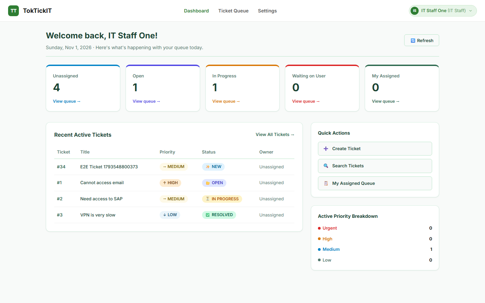  
*Figure 5.1: IT Staff Dashboard (IT Staff One / Priya Nair)*

### 5.2 Drill-down
  
*Figure 5.2: Drill-down - clicking "Unassigned" opens the Ticket Queue filtered to unassigned active Tickets*

### 5.3 Loading State
*Figure 5.3: Loading state - "Loading dashboard..."*

### 5.4 Empty State
*Figure 5.4: Empty state (Elena Rossi / IT Staff) - "You have no open actions."*

### 5.5 Forbidden
*Figure 5.5: Forbidden - a Requester calling /api/staff/dashboard receives 403. (Requester = Jennifer Anderson / Aran Edlek)*

### 5.6 Safe Failure
*Figure 5.6: Safe failure - "Unable to load the dashboard." with Retry when the API is unavailable.*

### 5.7 Responsive Behavior
  
*Figure 5.7a: IT Staff Dashboard on tablet (768 × 1024)*

  
*Figure 5.7b: IT Staff Dashboard on mobile (375 × 812)*

### 5.8 Metrics Match Database
*Figure 5.8: SQL query results matching the dashboard counts.*

---

## Answer Part 6: Working Actions Taken UI

### 6.1 Actions Taken List
  
*Figure 6.1: Actions Taken on TKT-2026-900003 - different actions with Completed, In Progress, and Cancelled statuses.*

### 6.2 Create and Assign
*Figure 6.2.1: View action taken*

  
*Figure 6.2.2: Add Action form - a new action assigned to Elena Rossi.*

### 6.3 Edit
*Figure 6.3: Edit Action - changing the description of an open action.*

### 6.4 Status Transition
*Figure 6.4: Start - action status changes from Planned to In Progress.*

### 6.5 Complete
*Figure 6.5: Complete - action status changes to Completed and becomes read-only.*

### 6.6 Cancel
*Figure 6.6: Cancel - confirmation dialog, then action status changes to Cancelled.*

### 6.7 Validation
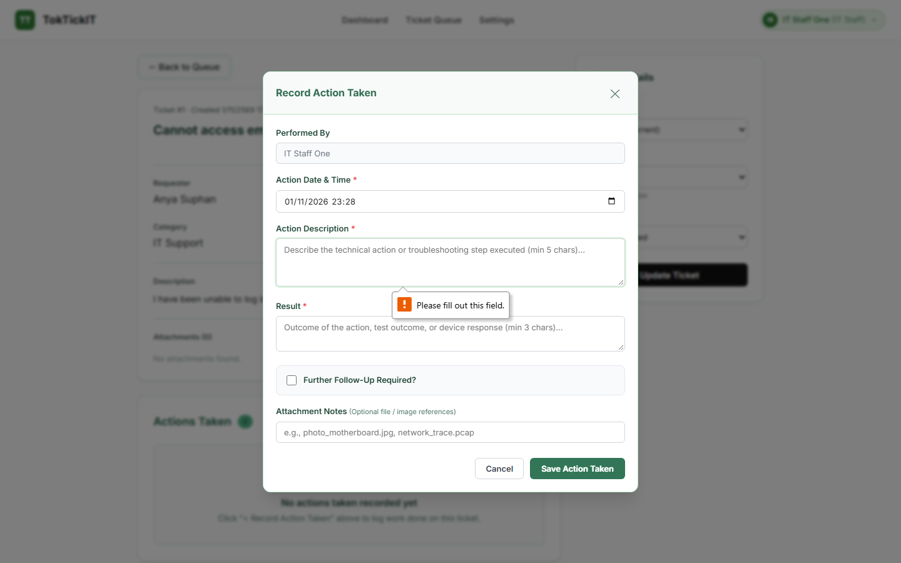  
*Figure 6.7: Validation errors shown under the required fields.*

### 6.8 Inactive-assignee Rejection
*Figure 6.8: Saving with an inactive assignee is rejected - "The assignee must be an active IT Staff or Administrator user."*

### 6.9 Role Restrictions
  
*Figure 6.9: Requester view - Actions Taken are read-only, with no Add, Edit, or status buttons.*

### 6.10 Safe Failure
*Figure 6.10: Safe failure - "Unable to save. Please try again." with the typed values kept.*

### 6.11 Responsive Behavior
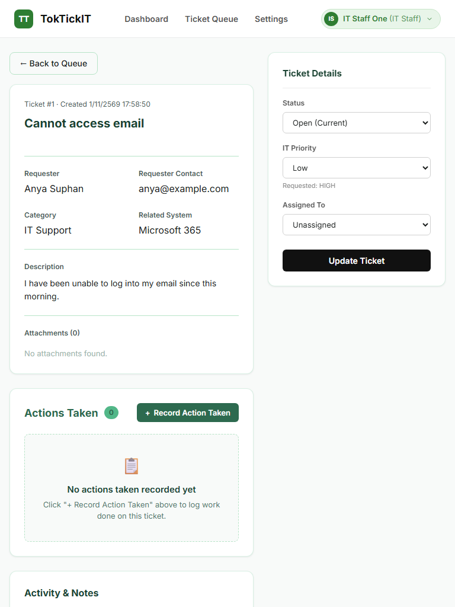  
*Figure 6.11a: Actions Taken on tablet (768 × 1024)*

  
*Figure 6.11b: Actions Taken on mobile (375 × 812)*

---

## Answer Part 7: Working Ticket Workflow

### 7.1 Permitted Transitions
  
*Figure 7.1: Status options for an In Progress Ticket - only Open, Waiting for Requester, Resolved, and Cancelled are offered.*

### 7.2 Resolution Gate
*Figure 7.2: Resolving is blocked while the Ticket still has an open action.*

### 7.3 Successful Transition
*Figure 7.3a: Confirmation dialog - "Change status to Resolved?".*  
*Figure 7.3b: Ticket status changed to Resolved after all actions are Completed or Cancelled.*

### 7.4 Stable Ordering and Append-only History
*Figure 7.4a: Status Timeline before the change.*  
*Figure 7.4b: Status Timeline after the change - the new entry is added at the bottom and earlier entries stay unchanged, with no edit or delete buttons.*

### 7.5 Role-appropriate Visibility
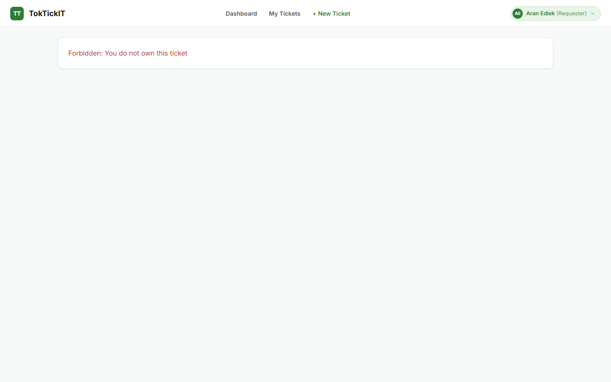  
*Figure 7.5: Requester view (Aran Edlek / Michael Brown) of the same Ticket - status, Actions Taken, and Status Timeline are visible but read-only, with no status controls.*

---

## Answer Part 8: Working Requester Dashboard and Final Regression UI

### 8.1 Requester Dashboard
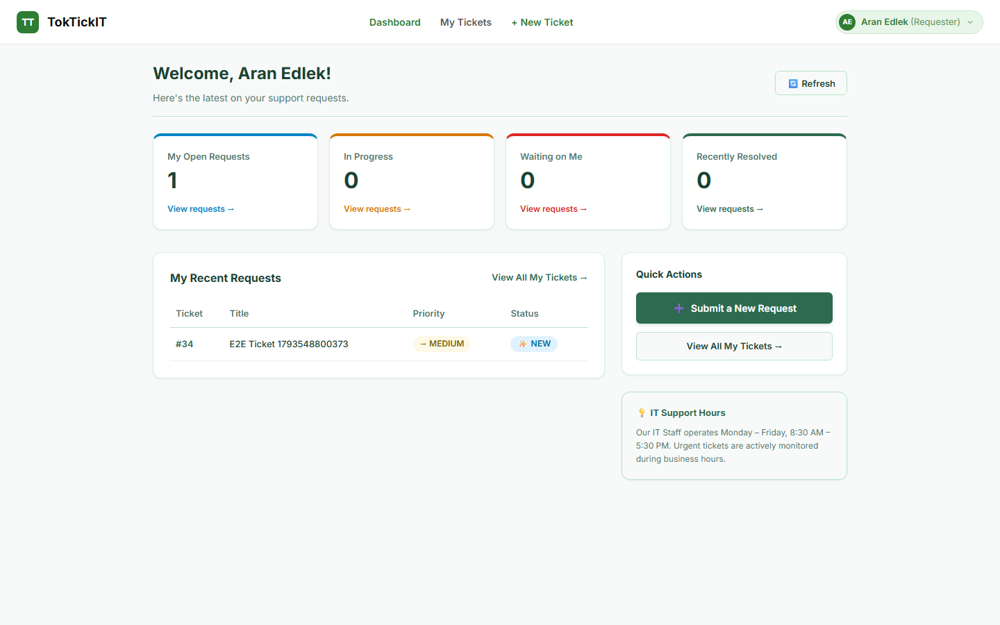  
*Figure 8.1: Requester Dashboard (Aran Edlek / Jennifer Anderson) - Open tickets, Waiting for me, Recently updated, and Recently resolved, counting only her own Tickets.*

### 8.2 Drill-down
  
*Figure 8.2: Drill-down - clicking "Open tickets" opens My Tickets filtered to her active Tickets, and the total matches the card.*

### 8.3 Ownership Protection
*Figure 8.3: Ownership protection - Requester requesting another Requester's Ticket (/api/tickets/:id) receives 404.*

### 8.4 Regression - Authentication
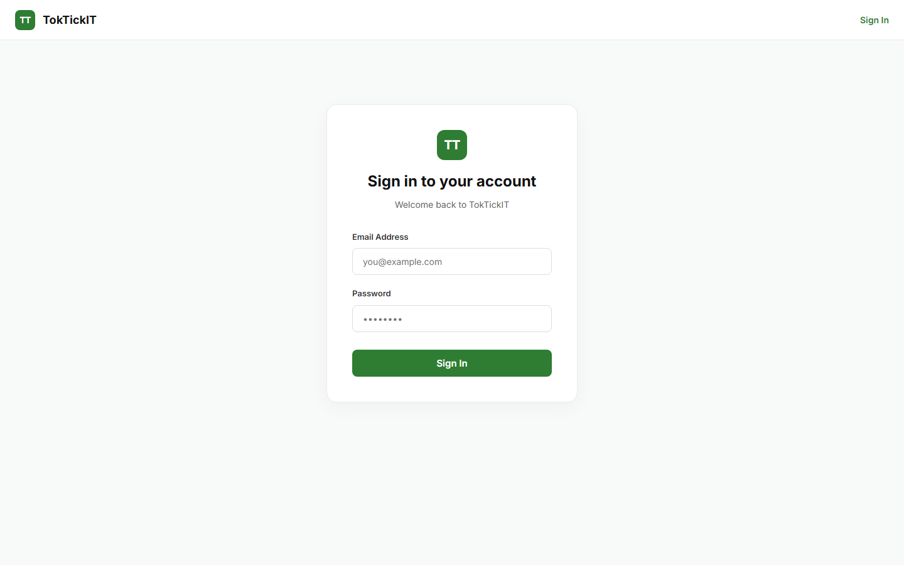  
*Figure 8.4: Login page - signing in with a seeded account.*

### 8.5 Regression - My Tickets
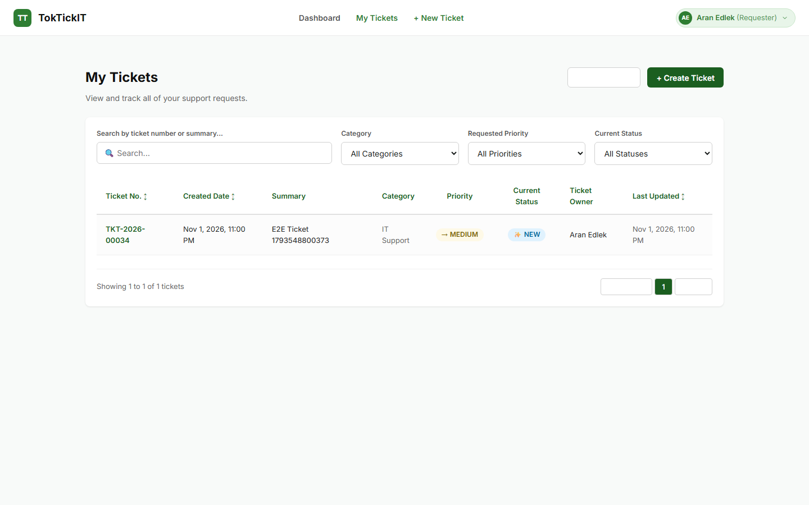  
*Figure 8.5: My Tickets list (Aran Edlek / Jennifer Anderson).*

### 8.6 Regression - Ticket Detail
  
*Figure 8.6: Requester Ticket Detail of TKT-2026-900002.*

### 8.7 Regression - Attachments
*Figure 8.7: Attachments - a file uploaded and listed on the Ticket.*

### 8.8 Regression - Public Comments
*Figure 8.8: Public Comments - the staff reply and a new comment from the Requester.*

### 8.9 Regression - IT Staff Functions
  
*Figure 8.9: IT Staff Ticket Queue with filters, and owner and IT Priority on Staff Ticket Detail.*

### 8.10 Regression - Internal Notes
*Figure 8.10: Internal Notes on TKT-2026-900002 - visible to IT Staff only.*

### 8.11 Regression - Administrator User Management
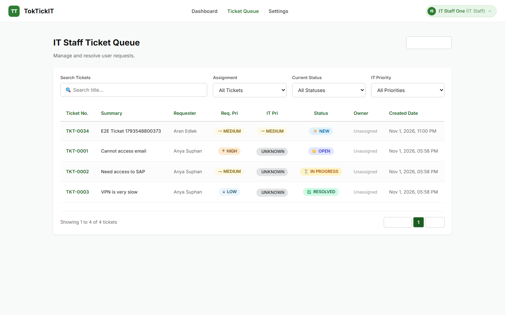  
*Figure 8.11: Administrator User Management - user list with roles and active status.*

---

## Answer Part 9: Zen Green UI, Responsive, Accessibility, and Final Polish

### 9.1 Rendered docs/lab-04/ui-spec.md

**Link :** [https://github.com/aranedlek/toctickit/blob/main/docs/lab-04/ui-spec.md](https://github.com/aranedlek/toctickit/blob/main/docs/lab-04/ui-spec.md)

*Figure 9.1: Rendered ui-spec.md - navigation, dashboards, Actions Taken, screen states, responsive rules, and accessibility.*

### 9.2 IT Staff Dashboard
  
*Figure 9.2a: IT Staff Dashboard on desktop (1440 × 900).*

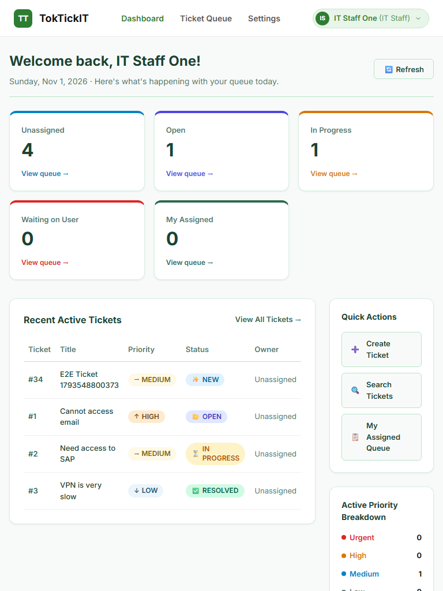  
*Figure 9.2b: IT Staff Dashboard on tablet (768 × 1024).*

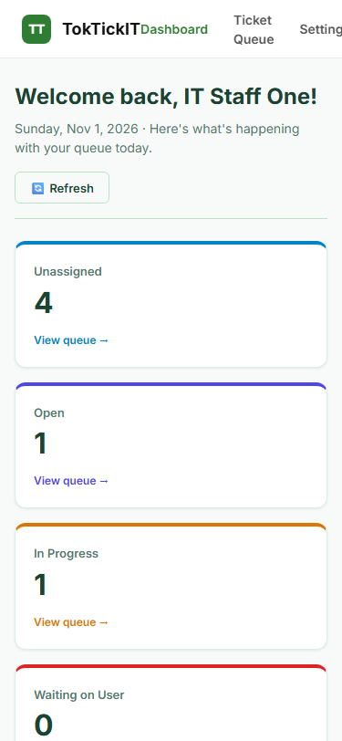  
*Figure 9.2c: IT Staff Dashboard on mobile (375 × 812).*

### 9.3 Requester Dashboard
  
*Figure 9.3a: Requester Dashboard on desktop (1440 × 900).*

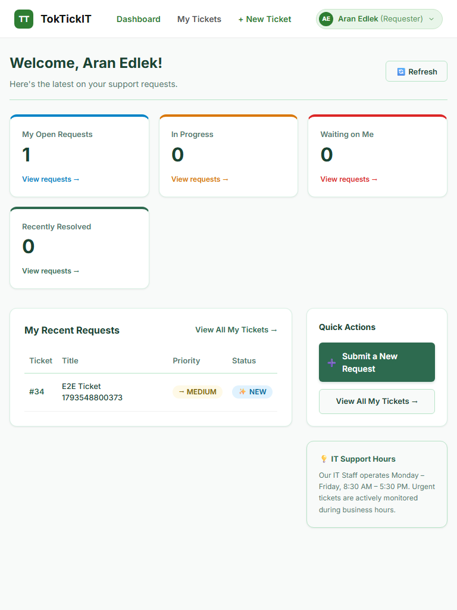  
*Figure 9.3b: Requester Dashboard on tablet (768 × 1024).*

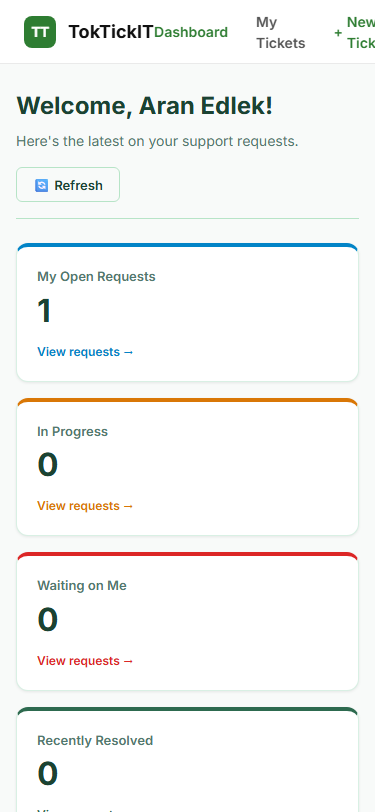  
*Figure 9.3c: Requester Dashboard on mobile (375 × 812).*

### 9.4 Actions Taken on Ticket Detail
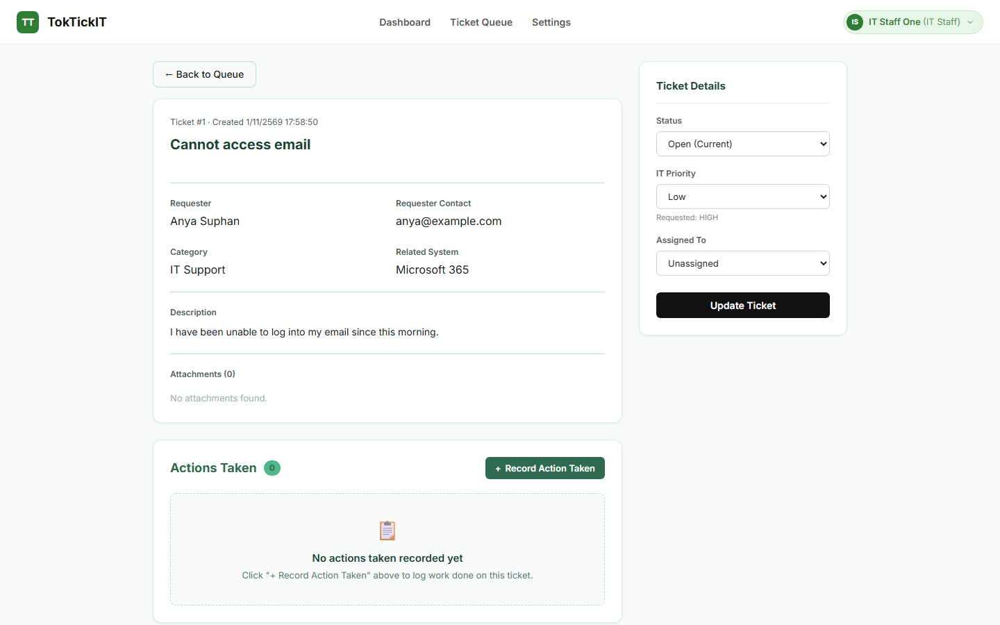  
*Figure 9.4a: Actions Taken on desktop.*

  
*Figure 9.4b: Actions Taken on tablet.*

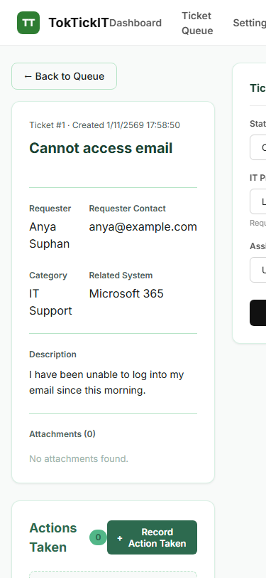  
*Figure 9.4c: Actions Taken on mobile.*

### 9.5 Keyboard Focus
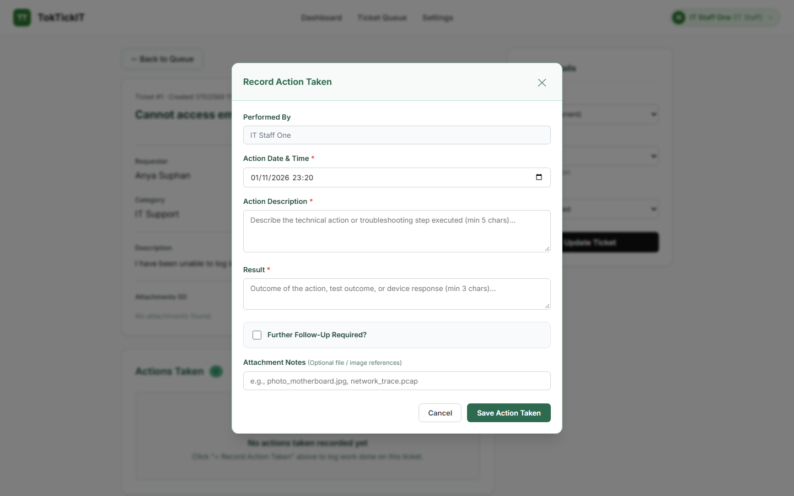  
*Figure 9.5: Visible keyboard focus ring on the Action Date and Time field.*

### 9.6 Visual and Accessibility Checklist
*Figure 9.6: Completed checklist - design consistency, dashboards, Actions Taken, editable/read-only fields, validation placement, keyboard focus, clipping, overlap, and horizontal overflow, all Pass.*

---

*Report generated: November 2026*  
*Student: Aran Edlek (อรัญ อีดเหล็ก) | ID: 67070505230*  
*Reviewer: Jinjutha Nannarumit (จินจุฑา นันนฤมิตร) | ID: 67070505232*  
*Course: CPE 334 Introduction to Software Engineering in the Age of AI Agents*
